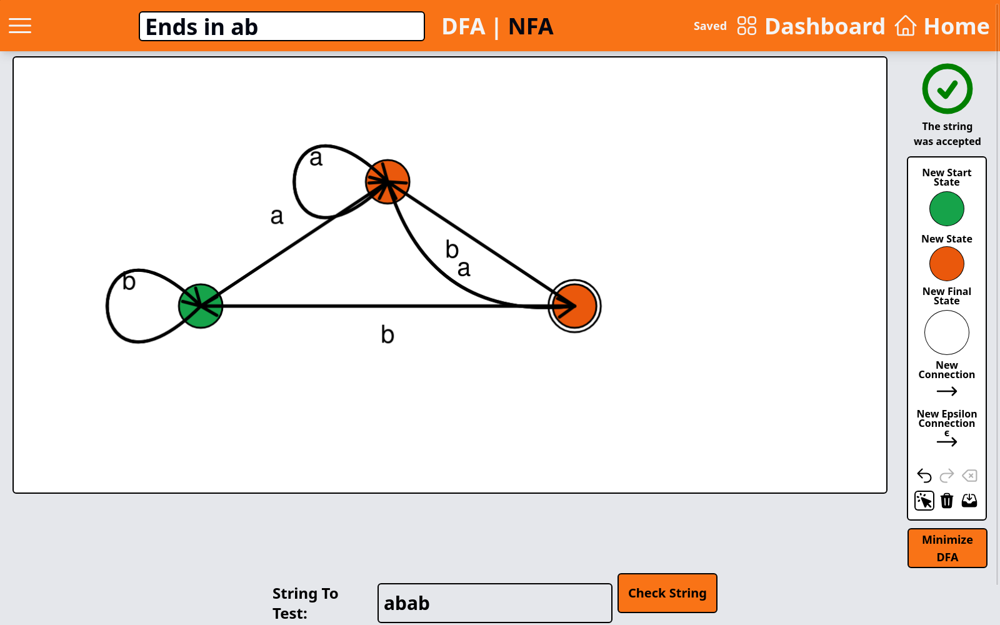

# Inner Machinations

A desktop app for creating, visualizing, and testing deterministic and non-deterministic finite automata, built with Rust, Tauri, SvelteKit, and SQLite.



I was inspired to make this project by my studies in discrete math at university, with the goal of letting anybody, anywhere create and visualize DFAs and NFAs, which have applications ranging from pattern matching to compiler theory.

## Features

- Draw DFAs and NFAs (including epsilon transitions) on a canvas
- Check whether an automaton accepts a given string
- Convert a regular expression to an NFA, and an NFA to an equivalent DFA
- Minimize a DFA
- Determine the language an automaton accepts
- Save automata to a local SQLite database under a user account

The regex-to-NFA conversion, DFA minimization, and state-transition logic are implemented from scratch in Rust (`src-tauri/src`).

## Running it locally

You need Rust, Node.js, and the [Tauri v1 prerequisites](https://v1.tauri.app/v1/guides/getting-started/prerequisites) for your OS.

```sh
npm install
npx tauri dev
```

Creating an account sends a verification code by email. To enable that, add `SMTP_USERNAME` and `SMTP_APP_PASSWORD` to the `.env` file the app creates on first run (see `.env.example`).
